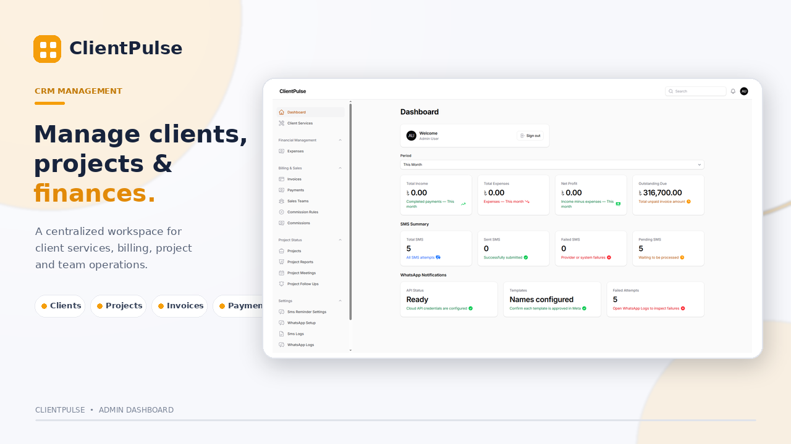

<h1 align="center">Hi 👋, I'm Md.Kamal Hossen</h1>

  

<h3>Laravel Web Developer | REST API Expert | Admin Panel Specialist | Open for work.</h3>

I help businesses build <strong>fast, scalable, and secure web applications</strong> using Laravel.

<ul>
  <li>✅ I specialize in <strong>Laravel development</strong> with 3+ years of real-world experience building secure, scalable, and maintainable applications.</li>
  <li>✅ Expert in REST APIs, MySQL, Eloquent ORM</li>
  <li>✅ Skilled in AJAX, dynamic admin panels & multi-vendor systems</li>
  <li>✅ Proficient in authentication, Blade templating, and backend logic</li>
</ul>

<h2 align="center">🚀 Featured Product — ClientPulse CRM</h2>

<h3 align="center">
  A Complete Laravel CRM & Business Management Solution
</h3>

  

  <strong>
    Laravel 12 | Filament 5 | PHP | MySQL | Docker
  </strong>

  ClientPulse CRM is a professionally developed business
  management solution for managing clients, projects,
  teams, invoices, payments, expenses and sales operations.

<h3>✨ Key Features</h3>

<ul>
  <li>Role-Based Portals — Admin, Account, Sales, Manager & Client</li>
  <li>Client and Project Management</li>
  <li>Invoice, Payment & Expense Management</li>
  <li>Sales Team & Commission Management</li>
  <li>SMS & WhatsApp Notifications</li>
  <li>Client Portal and Follow-up Management</li>
  <li>Role-Based Access Control</li>
</ul>

<h3 align="center">Explore & Purchase ClientPulse CRM</h3>

  
  
  

  <em>Designed & Developed by Md. Kamal Hossen</em>

<h3 align="left">Connect with me:</h3>

<h3 align="left">Languages and Tools:</h3>

